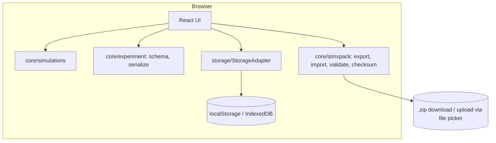
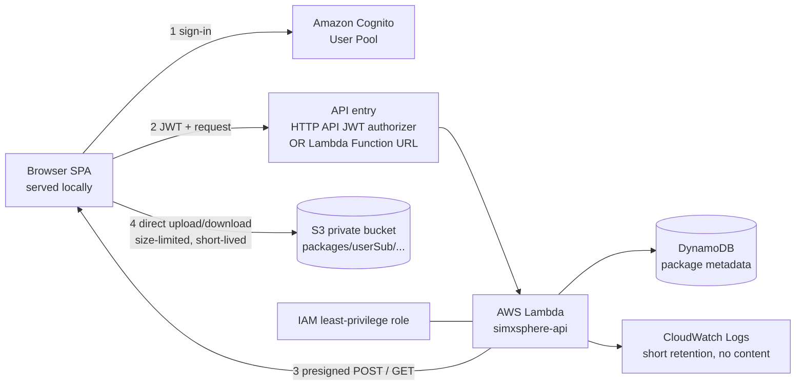

# ARCHITECTURE

## 1. Principles
Local-first. Pure simulation core. Storage behind an interface. Heavy work (simulation, ZIP, hashing) in the browser. Cloud is a thin private persistence layer.

## 2. Local mode


## 3. Storage interface (the seam between local and AWS)
```ts
export interface ExperimentStore {
  save(e: Experiment): Promise<void>;
  get(id: string): Promise<Experiment | null>;
  list(): Promise<ExperimentSummary[]>;
  remove(id: string): Promise<void>;
}
export interface PackageStore {            // cloud mode adds this
  put(meta: PackageMeta, zip: Uint8Array): Promise<string>;   // returns packageId
  list(): Promise<PackageMeta[]>;
  getDownloadBytes(id: string): Promise<Uint8Array>;
  remove(id: string): Promise<void>;
}
```
`localAdapter` implements `ExperimentStore` (and a no-op/unsupported `PackageStore`). `awsAdapter` implements both. The UI shows cloud controls only when `PackageStore` is configured.

## 4. Optional AWS cloud mode (target design)
All services below are **candidates, VERIFY BEFORE USE** (see AWS_FREE_COST_CHECKLIST.md). Each has a reason and a removal path.



| Service | Why it is needed | Removal |
|---|---|---|
| Cognito User Pool | Identity: ownership enforced by the token's `sub` | delete pool |
| API entry (HTTP API + JWT authorizer *or* Lambda Function URL) | Reach Lambda over HTTPS; one of the two, chosen at the cost gate | delete API / function URL |
| Lambda (one function, small router) | Issue presigned URLs, read/write metadata, enforce ownership and limits | delete function |
| DynamoDB (one table) | Package list/metadata without scanning S3 | delete table |
| S3 (one private bucket) | Stores the ZIP exactly as exported | empty, then delete bucket |
| CloudWatch Logs | Operational errors only; retention 3-7 days | delete log group |
| IAM role/policies | Least privilege for Lambda | delete role |
| CloudFormation / SAM | One-command create and delete | delete stack |

**Deliberately excluded:** CloudFront, EC2, RDS, NAT Gateway, load balancers, WAF, SQS/SNS/EventBridge/Step Functions, public S3 website hosting, custom domains. (Frontend stays local; hosting it on AWS is a verified-optional extra, not default.)

### 4.1 Cloud data flows
**Upload a package**
1. UI builds ZIP in the browser (SimXPack) and computes SHA-256.
2. `POST /packages` {name, sizeBytes, sha256, experimentCount} + JWT -> Lambda validates (size <= limit, name rules), derives `userSub` from the token, writes a `PENDING` metadata item, returns a **presigned POST** for `packages/{userSub}/{packageId}.zip` with `content-length-range` condition and short expiry.
3. Browser uploads directly to S3.
4. `POST /packages/{id}/complete` -> Lambda `HeadObject` checks size, sets `READY`.

**Download / share**
1. `GET /packages/{id}/download-url` -> Lambda checks the item belongs to `sub`, returns a **presigned GET** (about 5 min expiry).
2. The user may pass that file to someone; the link expires. No permanent public links.

**List / delete**: `GET /packages`, `DELETE /packages/{id}` (deletes S3 object + metadata item; both scoped to `sub`).

### 4.2 DynamoDB item (example)
```json
{ "PK": "USER#<sub>", "SK": "PKG#<packageId>", "name": "Week 3 runs",
  "createdAt": "2026-10-19T10:00:00Z", "sizeBytes": 4210, "sha256": "...",
  "experimentCount": 3, "status": "READY", "s3Key": "packages/<sub>/<packageId>.zip" }
```
Access pattern: `Query PK = USER#<sub>, begins_with(SK, "PKG#")`. No scans.

### 4.3 S3 configuration
Block Public Access ON (all four); default encryption SSE-S3; versioning OFF (avoids hidden storage); lifecycle rule to expire objects after N days; CORS limited to the app origin; bucket policy has no public principals; no website hosting.

### 4.4 API contract
| Method + path | Body / result |
|---|---|
| POST /packages | metadata -> `{packageId, upload:{url, fields}}` |
| POST /packages/{id}/complete | -> `{status:"READY"}` |
| GET /packages | -> `[PackageMeta]` |
| GET /packages/{id}/download-url | -> `{url, expiresInSeconds}` |
| DELETE /packages/{id} | -> `204` |

## 5. Why browser-side compute
Simulation and ZIP run on the client, so AWS compute use is limited to tiny metadata calls. This keeps cost exposure low and keeps the app functional without AWS.

## 6. Local vs cloud summary
| Concern | Local | Cloud (if enabled) |
|---|---|---|
| Identity | none | Cognito |
| Experiment store | browser storage | browser storage + packages in S3 |
| Package store | user's disk | S3 + DynamoDB |
| Sharing | manual file | short-lived presigned link |
| Cost | none | must pass cost gate |
