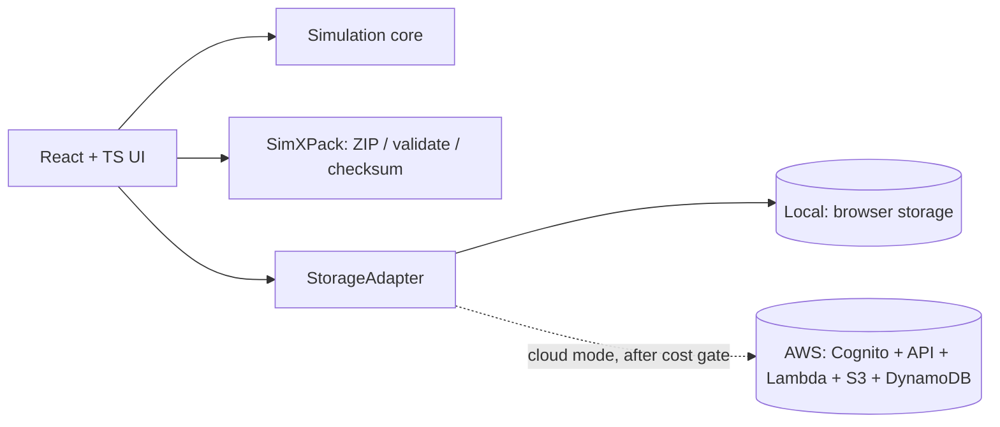

# SimXSphere

**An Interactive Simulation Platform with Experiment Packaging, Compression, Export, and Sharing**

> Sim = Simulation · X = eXport/Transfer · Sphere = one platform for experiments and their results

## 1. What it is
A small web app where you run two simulations, tune parameters, view graphs, save experiments, group 2-4 of them into a **collection**, export it as one lossless **SimXPack** ZIP, and import it later to restore the experiments exactly.

The app is useful on its own (local mode). **AWS provides the cloud layer**: private storage of packages (S3), experiment metadata (DynamoDB), authenticated access (Cognito), and small backend functions (Lambda). See [ARCHITECTURE.md](ARCHITECTURE.md) and [AWS_FREE_COST_CHECKLIST.md](AWS_FREE_COST_CHECKLIST.md).

## 2. Two run modes
| Mode | Needs AWS? | Status |
|---|---|---|
| **Local mode** (default) | No | Fully working; built in Milestones 1-6 |
| **Cloud mode** (AWS) | Yes | Fully *designed* in the docs; *deployed* only after the account-specific cost gate passes (Milestone 7) |

Both modes use the same UI and the same `StorageAdapter` interface; only the adapter changes.

## 3. MVP features
- Probability simulation (coin / dice): trial count, seeded RNG, counts, observed proportions, histogram.
- Projectile motion: speed, angle, gravity; trajectory graph, range, flight time, max height (idealized, no air resistance).
- Save / restore experiments (browser storage behind an adapter).
- SimXPack: 2-4 experiments -> manifest + JSON (+ optional CSV) -> ZIP (DEFLATE, lossless), SHA-256 checksums, size stats, strict import validation.
- Share = download the ZIP and send it manually. (Cloud mode: private S3 + short-lived signed links.)

## 4. Explicit non-goals
ML/AI, microservices, social features, general file sharing, management features, extra simulations (future), automatic relatedness detection, public links, auto-deployment, services added only to raise the AWS count.

## 5. Cost rule (read first)
Default = **no AWS resources are created**. AWS free eligibility depends on account type/age, region, current offers, usage and data transfer. Budgets/alerts only notify; they do not cap spending. Nothing here is "guaranteed free". Every AWS item is marked **VERIFY BEFORE USE**. See [AWS_FREE_COST_CHECKLIST.md](AWS_FREE_COST_CHECKLIST.md).

## 6. Quick start (after Milestone 1)
```bash
npm install
npm run dev        # http://localhost:5173
npm test           # unit + integration (Vitest)
npm run test:e2e   # UI workflows (Playwright)
npm run build
```

## 7. Architecture at a glance


## 8. Documentation map
| File | Purpose |
|---|---|
| [PROJECT_PLAN.md](PROJECT_PLAN.md) | Milestones, risks, scope control |
| [ARCHITECTURE.md](ARCHITECTURE.md) | Local + AWS architecture, diagrams, data flow |
| [SIMULATIONS.md](SIMULATIONS.md) | Formulas, bounds, edge cases, test vectors |
| [EXPERIMENT_SCHEMA.md](EXPERIMENT_SCHEMA.md) | Versioned experiment JSON |
| [SIMXPACK_SPEC.md](SIMXPACK_SPEC.md) | ZIP layout, manifest, validation, checksums |
| [AWS_FREE_COST_CHECKLIST.md](AWS_FREE_COST_CHECKLIST.md) | Per-service pricing links, gate, teardown |
| [SECURITY.md](SECURITY.md) | Threat model, IAM, validation |
| [TEST_PLAN.md](TEST_PLAN.md) | Unit / integration / UI / manual tests |
| [IMPLEMENTATION_WORKFLOW.md](IMPLEMENTATION_WORKFLOW.md) | Build order and gates |
| [DEPLOYMENT_GUIDE.md](DEPLOYMENT_GUIDE.md) | Local deploy; optional AWS deploy; rollback |
| [REPOSITORY_STRUCTURE.md](REPOSITORY_STRUCTURE.md) | Folder tree and responsibilities |
| [ACADEMIC_REPORT_AND_DEMO.md](ACADEMIC_REPORT_AND_DEMO.md) | Report outline, demo, metrics |
| [VIVA_QUESTIONS.md](VIVA_QUESTIONS.md) | Likely questions + answers |
| [AI_AGENT_PROMPTS.md](AI_AGENT_PROMPTS.md) | One prompt per milestone |

## 4b. Assumptions (conservative)
- One developer, Windows/macOS/Linux, current Node.js LTS.
- Stack: Vite + React + TypeScript; Vitest; Playwright; hand-written SVG charts (no chart library); `fflate` for ZIP (to be re-verified at Milestone 5: license, API, bundle size); Web Crypto for SHA-256.
- Cloud region/account are chosen by the student at Milestone 7, not before.
